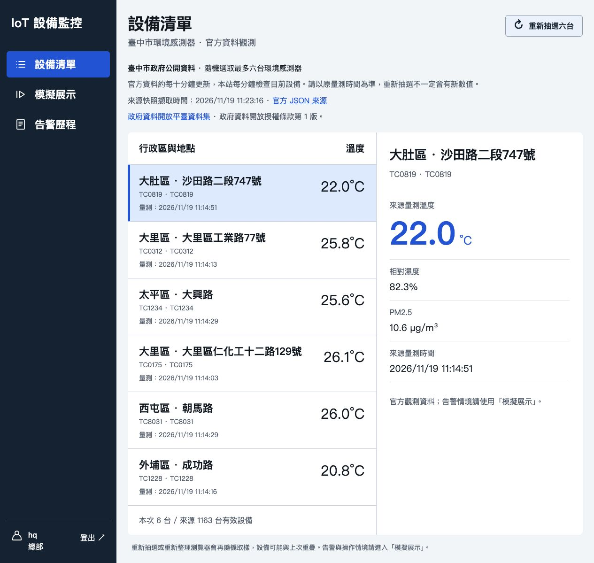

# IoT 設備監控與告警

一套在本機運行的設備監控系統。預設隨機查看六台臺中市政府環境感測器的官方觀測；另提供多場域模擬展示，追蹤溫度、在線狀態、異常恢復與人工結案。



*官方資料頁的設備清單與詳情。名稱跟隨來源行政區與地點，數值及量測時間均來自同一筆觀測；按「重新抽選六台」可再次隨機取樣。*

## 主要功能

- **官方環境觀測**：登入後隨機顯示最多六台不重複的臺中市感測器，預選第一台。重新抽選或瀏覽器重新整理會重新取樣，抽樣可能重疊；背景每分鐘保留目前設備同步，並保留手動選取。來源不足六台、沒有有效資料或暫時失敗時明確提示，不補入模擬值。
- **模擬場域權限**：進入「模擬展示」，總部可查看北區、南區六台模擬設備；場域帳號僅能查看所屬場域的三台設備與告警。官方公開觀測對所有已登入帳號相同，不套用模擬場域範圍。
- **模擬設備與展示情境**：六台模擬設備由服務自動回報，各自以不同基準每五秒小幅變動。進入模擬清單預選可見的第一台設備；手動改選後保留選取，總部可切換異常、停止、重送及恢復正常情境。
- **模擬異常與恢復**：模擬溫度超出 18～28°C 或超過 15 秒未收到有效回報時建立告警。離線保留最後有效值，並清楚標示資料已非即時。這些規則不套用官方觀測。
- **告警結案**：異常恢復後，可填寫處理結果並結案；結案人、時間及純文字結果保留為唯讀歷程。
- **模擬即時同步與復原**：透過 SSE 更新授權範圍內的模擬畫面，斷線後重新讀回快照；重啟保留模擬資料，另提供本機確認式展示重設。

官方來源為[臺中市環境感測資料集](https://data.gov.tw/dataset/152428)，採政府資料開放授權條款第 1 版，無需 API key。來源描述每分鐘量測、資料集約每十分鐘更新；後端以固定官方 HTTPS 來源取得資料，成功快照共用快取十分鐘。畫面分開標示來源量測時間與快照擷取時間；下載成功不代表設備在線，官方更新頻率也不代表本機模擬 SSE 的效能。詳見[官方資料 API 與更新界線](docs/operations.md#官方資料-api-與更新界線)。

## 技術

| 層面 | 技術 |
| --- | --- |
| 前端 | Vue 3、TypeScript、Vite |
| 後端 | Go 1.27、Gin |
| 資料庫 | PostgreSQL 18、pgx |
| 即時更新 | Server-Sent Events（SSE） |
| 本機環境與測試 | Docker Compose、Go 測試、Node.js、Playwright Core、Chrome |

前端以明確 DTO、HTTP 邊界、會話生命週期及設備／告警用例分工，Vue 元件負責畫面與焦點。Go 沿用登入授權、測量採用、告警、模擬控制及查詢責任，以輸入／回應 DTO 隔離資料庫模型；交易與權限仍由後端執行。[程式責任與 DTO](docs/project-guide.md#程式責任與-dto)

## 啟動與測試

需要本機 Docker Engine、Docker Compose 與 OpenSSL。以下命令皆在專案根目錄執行。

### 本機啟動

```sh
./bin/start
```

開啟 [http://iot.localhost:18241](http://iot.localhost:18241)。首次啟動後，在自己的本機查看 `.local/demo-passwords.json` 取得隨機示範密碼。帳號為 `hq`（總部）、`north`（北區）、`south`（南區）。網站只綁定本機 loopback，資料庫留在 Compose 網路。

### 停止與再啟動

在啟動時使用的專案根目錄與 Docker 環境執行下列命令。先核對容器歸屬，再依序停止本案應用與資料庫：

```sh
(
  set -eu
  if [ -n "${DOCKER_CONTEXT:-}" ] || [ -z "${DOCKER_HOST:-}" ]; then
    unset DOCKER_HOST
    context=$(docker context show)
    endpoint=$(docker context inspect "$context" --format '{{.Endpoints.docker.Host}}')
  else
    endpoint=$DOCKER_HOST
  fi
  case "$endpoint" in
    unix:///?*) ;;
    *) printf '%s\n' '需要與啟動時相同的本機 Docker Unix socket。' >&2; exit 1 ;;
  esac
  unset DOCKER_CONTEXT DOCKER_HOST
  root=$(pwd -P)
  project=iot-monitoring
  owned_id() {
    service=$1
    inspected=$(docker --host "$endpoint" container inspect --format \
      '{{.Id}}|{{index .Config.Labels "com.docker.compose.project.working_dir"}}|{{index .Config.Labels "com.docker.compose.project.config_files"}}|{{index .Config.Labels "com.docker.compose.project"}}|{{index .Config.Labels "com.docker.compose.service"}}' \
      "$project-$service-1") || return 1
    if [ "${inspected#*|}" != "$root|$root/compose.yaml|$project|$service" ]; then
      printf '%s\n' 'Compose 容器不屬於目前的工作目錄。' >&2
      return 1
    fi
    printf '%s\n' "${inspected%%|*}"
  }
  app_id=$(owned_id app)
  db_id=$(owned_id db)
  docker --host "$endpoint" container stop "$app_id"
  docker --host "$endpoint" container stop "$db_id"
)
```

停止會保留本案 `data` 資料卷及 `.local/`；再次執行 `./bin/start` 即可繼續使用原資料與憑證。

### 重設展示資料

先以 `./bin/start` 啟動目前版本並保持資料庫執行，再執行：

```sh
./bin/reset
```

核對預覽後，輸入 `RESET iot-monitoring` 確認。重設會清除本機模擬測量、告警、結案、控制歷程、登入與限流資料，再重建預載帳號、場域及設備；沒有備份就無法復原。資料卷、`.local/` 與原有示範密碼保留，完成後應用會自動啟動，請重新登入。此命令不會更動市府公開資料。輸入其他文字或直接按 Enter 可取消。[重設失敗與復原](docs/operations.md#本機展示重設)

### 手動驗證

1. 以任一帳號登入，預設進入官方「設備清單」，核對來源名稱、量測值與時間；按「重新抽選六台」或重新整理瀏覽器可重新取樣。要展示告警流程，以 `hq` 選「模擬展示」（也可直接開啟 `/?view=simulation`），畫面預選「北區設備 01」。確認六台模擬設備已有不同的正常溫度，並每五秒小幅變動，不需先按按鈕。按「開始異常回報」後應顯示 30.0°C，告警歷程出現該設備的溫度異常。
2. 按「停止回報」，等待超過 15 秒後確認離線及「資料已非即時」，最後有效溫度仍為 30.0°C。
3. 按「恢復正常」，確認恢復在線且溫度回到 18～28°C 的正常區間並持續小幅變動；回到告警歷程，原溫度告警應為「已恢復、待結案」。
4. 開啟該筆告警，輸入處理結果並「結案」。確認狀態為「已結案」，處理人、時間及結果唯讀保留。操作結果未確認時，先依畫面提示讀回資料，再決定是否重試。

### 自動化測試

自動化測試需 Node.js 24.22.2、Go 1.27.3、本機 Docker 及 Chrome／Chromium；非預設瀏覽器路徑可用 `CHROME_EXECUTABLE` 指定。測試使用隔離的 Compose 專案、連接埠與資料卷。

```sh
(cd tests && npm ci && npm test -- --test-concurrency=1)
./bin/test-measurements
./bin/test-measurements automatic
./bin/test-measurements --race automatic
(cd backend && go test ./... && go vet ./... && go build -o /dev/null .)
(cd frontend && npm ci && npm run typecheck && npm run build)
```

`test-measurements --race` 由專用 Docker 測試目標提供 Go 與 C 工具鏈，所有測試組別都可加此前綴；正式映像不包含這些工具。不加 `--race` 的模式仍需要本機 Go 1.27.3。

[完整操作與工程手冊](docs/operations.md)保留安全停機、重啟、重設與失敗復原、API、各組整合測試及正式效能驗收方式。[專案與測試指南](docs/project-guide.md)整理技術、測試範圍與 v0.1 歷史實測；這些歷史數據不是本次介面改版的新測試結果。
